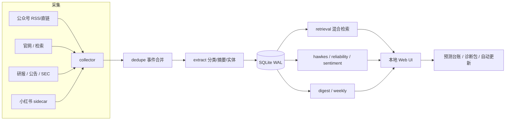
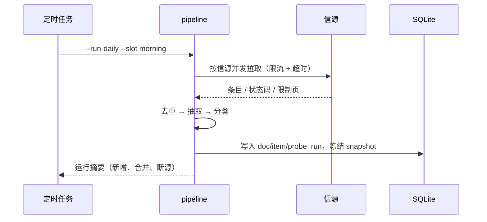

# 产业链情报台 · LLM Intel Agent

面向 AI 产业链的**本地优先**情报工作台：多源采集、事件级去重、双时间轴留痕、可追溯检索与预测复盘。

不是又一个资讯聚合器。它只关心三件事：**不漏、可查、可复盘**。

- 版本：1.9.7
- 平台：macOS 13+
- 运行时：Python 3.12（标准库实现，可选 `segno` 用于生成登录二维码）
- 存储：本地 SQLite（WAL），数据不出本机

---

## 它解决什么问题

| 痛点 | 做法 |
|---|---|
| 信息散在公众号、官网、研报、公告、SEC、小红书 | 统一采集入口 + 信源健康度，断源当天可见 |
| 同一件事被几十家转载 | 标题指纹 + 事件级合并，去重后按事件计数 |
| 结论说不清从哪来 | 每条结论挂 `item id`，可回溯到原文与快照 |
| 事后看什么都“早有预兆” | `snapshot` 冻结当次运行，预测挂在快照上防后视偏差 |
| 模型 Key 明文躺在配置里 | macOS Keychain 存 Key，配置只存引用 |

---

## 核心能力

| 模块 | 说明 |
|---|---|
| 多源采集 | 公众号（RSS + 直链）、官网新闻、人物检索、券商研报、上市公司公告、SEC EDGAR、小红书（可选） |
| 采集可观测 | 每次运行记录 `probe_run` 四态：`ok / zero_hit / unavailable / parse_broken`，另有 `rate_limited` 冷却态 |
| 双时间轴 | `t_valid`（事件发生/发布）与 `t_txn`（我们入库）分离，永不 UPDATE |
| 事件去重 | URL/标题指纹 + 实体与动作合并，保留首个与最新两条时间锚点 |
| 抽取与分类 | 可选 LLM 摘要，未配置 Key 时降级为规则抽取，不阻断采集 |
| 混合检索 | BM25 + 字符 n-gram + RRF 融合，中文短查询也能召回 |
| 趋势检测 | 单变量 Hawkes 强度估计 + 泊松基线对照，输出异常窗口 |
| 信源可靠度 | 按历史命中/错误率滚动评分，低可靠源降权而非直接丢弃 |
| 情感复核 | 标题态度与评论区风向分开统计，避免把媒体措辞当成真实情绪 |
| 预测台账 | 命题 → 快照 → 到期结算，记录命中率而不是只展示“预测带” |
| 简报与周报 | 每日 08:00 / 20:00 采集，周一 09:00 周报（按公司聚合 + 环比） |
| 限流守卫 | 识别公众号限制页与 HTTP 429，主动停止本轮直链并进入冷却，避免加重封禁 |
| 自动更新 | 清单签名校验 → 下载 → sha256 校验 → 替换 → 失败回滚 |

> 已知取舍：每日产物是**按评分排序的情报流**，不是成篇的分析早报；跨日归纳与推送尚未内置。周报才做公司级聚合。公众号阅读/点赞数微信不公开，因此不展示。

---

## 架构



一次采集的完整链路：



---

## 界面

| 页面 | 内容 |
|---|---|
| 情报总览 | 缺口（需求−供给）、需求增长、预测带、舆情双轨、事件时间轴、钱/卡/资源流向 |
| 智谱 · 唐杰 | 报道、唐杰提及、一手发言、标题态度、小红书评论风向、相关条目 |
| 周报 | 本周综述、按公司归类、周环比 |
| 任务 | 采集/深挖/预测的运行流水与耗时 |
| 竞对 | 竞对动态与横向对比 |
| 信源 | 全部信源、健康度、公众号订阅与限流冷却状态 |
| 系统 | 模型与采集配置、诊断包、版本与更新 |

所有页面由同一个本地 HTTP 服务提供（默认随机端口），只监听 `127.0.0.1`。

---

## 快速开始

```bash
git clone https://github.com/m-wzx-crypto/llm-intel-agent.git
cd llm-intel-agent
python3 src/main.py
```

首次启动会打开配置向导，填入模型地址与 Key（Key 写入 Keychain，不落配置文件）。

常用参数：

```bash
python3 src/main.py                 # 启动界面
python3 src/main.py --run-daily     # 采集一次后退出（定时任务用）
python3 src/main.py --port 8765     # 指定端口
python3 src/main.py --no-open       # 不自动打开浏览器
```

数据目录：`~/Library/Application Support/LLMIntelAgent/`（可用 `LLMINTEL_HOME` 覆盖）

### 定时任务（macOS launchd）

```bash
bash build/install-launchd.sh install   # 早报 08:00 / 晚报 20:00 / 周报 周一 09:00
bash build/install-launchd.sh status
bash build/install-launchd.sh remove
```

### 打包为 .app

需要自备 Apple Developer ID 与 `notarytool` 凭据：

```bash
pyinstaller build/LLMIntelAgent.spec        # 需自行按本机路径调整 spec
codesign --deep --options runtime --sign "Developer ID Application: ..." dist/LLMIntelAgent.app
xcrun notarytool submit ... && xcrun stapler staple dist/LLMIntelAgent.app
```

---

## 配置

配置文件：`~/Library/Application Support/LLMIntelAgent/config.json`

关键项：

| 键 | 说明 |
|---|---|
| `llm.base_url` / `llm.model` | 兼容 OpenAI 协议的任意网关 |
| `llm.api_key` | 通常为空，实际 Key 在 Keychain（service `LLMIntelAgent`） |
| `llm_profiles` | 多套模型档案，可随时切换 |
| `schedule.morning` / `evening` | 采集时间 |
| `schedule.token_budget_daily` | 每日 token 预算，晚报在余量不足时自动跳过 |
| `channels.wechat_*` | 公众号直链、RSS、冷却时长 |
| `channels.xiaohongshu_*` | 小红书三面板关键词、每词笔记数、评论数 |

环境变量：

- `LLMINTEL_HOME`：覆盖数据目录
- `LLMINTEL_KEYCHAIN=0`：强制关闭 Keychain（测试或排障）
- `LLMINTEL_UPDATE_URL`：覆盖更新清单地址

---

## 数据源与边界

| 信源 | 方式 | 说明 |
|---|---|---|
| 微信公众号 | RSS 镜像 + 文章直链 | 识别限制页/429 后进入冷却，冷却期内不再请求直链 |
| 智谱官网 | 新闻列表翻页 | 只取标题、时间、链接与正文 |
| 人物检索 | 搜索引擎结果页 | 用于补齐唐杰等一手发言 |
| 券商研报 | 东方财富公开接口 | 按 AI 产业链关键词过滤 |
| 上市公司公告 | 巨潮公开接口 | 关键词检索 + AI 主体认领 |
| 美股披露 | SEC EDGAR | 关注清单 + 事件类表单过滤 |
| 小红书 | `off / local / vendor` 三档 | 默认关闭；`local` 使用本机 sidecar，登录态与数据都不出网 |

明确不做：

- **X / Twitter**：境内网络不可达，第三方代理取数涉及平台条款与合规风险，因此不内置抓取。
- 公众号阅读数、点赞数：微信不公开。
- PDF 图表结构化抽取：仅保留原文链接，不做图表还原。

所有内容版权归原站点，本项目只做本地索引与检索，不二次分发。

---

## 测试

测试均为可直接运行的脚本（无需 pytest）：

```bash
python3 tests/test_updater.py
python3 tests/test_wechat_guard.py
python3 tests/test_social.py
python3 tests/test_entities.py
python3 tests/test_retrieval.py
python3 tests/test_hawkes.py
python3 tests/test_secrets_store.py
node tests/render_flow_smoke.mjs        # 前端渲染冒烟
```

覆盖：更新清单校验与跳过、限流识别与冷却、三面板关键词轮转与缓存合并、实体消歧、混合检索、Hawkes 数值稳定性、Keychain 降级。

---

## 项目结构

```text
src/            应用主体（采集、去重、抽取、检索、分析、Web 服务）
  web/          单文件前端（无构建步骤）
tests/          可直接运行的测试脚本
build/          launchd plist、安装脚本、验收脚本
docs/           技术方案与架构决策记录
scripts/        开发辅助脚本
```

---

## 隐私与合规

- 数据只写本机 SQLite，不上传任何第三方
- 模型 Key 存 macOS Keychain，配置文件中不保存明文
- 不登录、不逆向签名、不绕过平台鉴权
- 采集遵守站点频率限制，并对已知限流做退避
- 使用者需自行确保其采集行为符合所在地区法律与目标站点条款

---

## 许可证

本项目采用 [PolyForm Noncommercial License 1.0.0](LICENSE)：

- **允许**：个人学习、研究、非商业自用，以及基于它的非商业修改与分发
- **禁止**：任何商业目的的使用、部署、转售或作为商业产品的一部分
- **商业授权**：如需商用，请通过 GitHub Issues 联系作者单独授权

需要说明：带“禁止商用”限制的许可证不属于 OSI 定义的开源许可证，属于 **source-available**。仓库公开可读，但商用需授权。

---

## 免责声明

本项目仅用于信息聚合与技术研究。采集内容的事实性、完整性与时效性不做保证，不构成任何投资建议。因使用本项目产生的合规与法律责任由使用者自行承担。

---

## English Summary

LLM Intel Agent is a local-first macOS intelligence workbench for the AI industry. It collects from WeChat, official sites, research reports, filings and SEC EDGAR, deduplicates at the event level, keeps a dual-timeline record, and offers hybrid retrieval, Hawkes-based trend detection, source reliability scoring and a prediction ledger. Data stays on the local machine; model keys live in the macOS Keychain.

Licensed under PolyForm Noncommercial 1.0.0 — free for personal and noncommercial use, commercial use requires a separate license.
